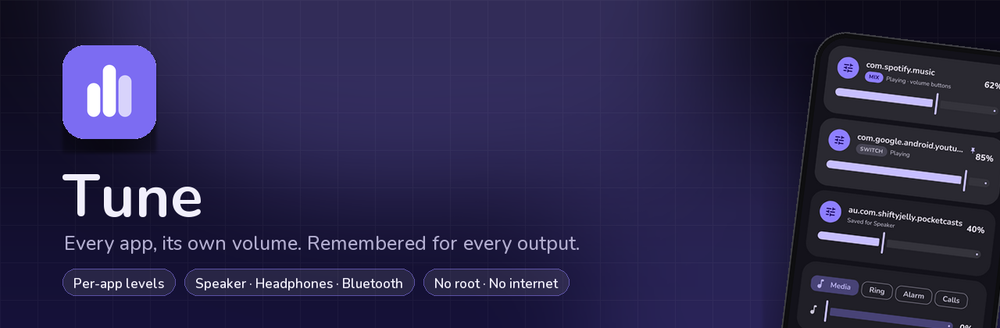
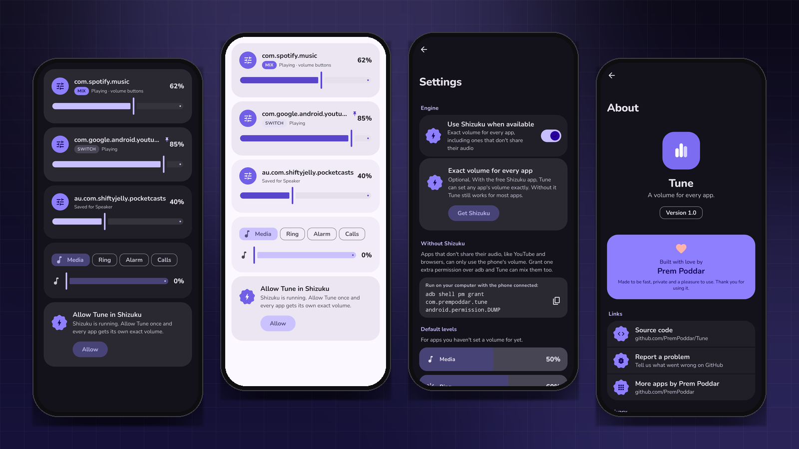
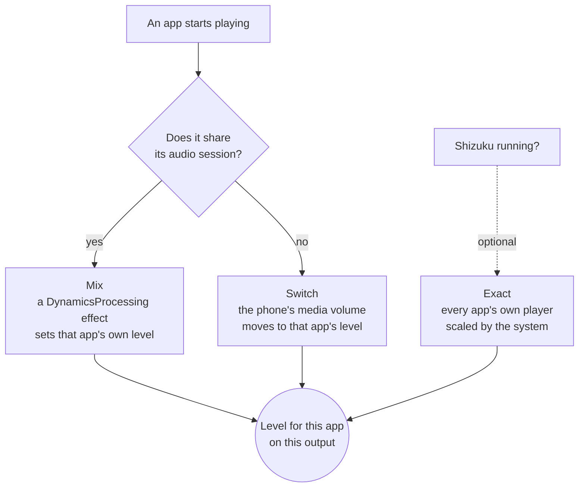

<div align="center">



<br><br>

[](https://developer.android.com)
[](https://kotlinlang.org)
[](https://developer.android.com/compose)
[](LICENSE)
[](https://prempoddar.github.io/Tune/)

**[Website](https://prempoddar.github.io/Tune/)** · **[Download](https://github.com/PremPoddar/Tune/releases)** · **[Privacy](https://prempoddar.github.io/Tune/privacy/)** · **[Report a problem](https://github.com/PremPoddar/Tune/issues)**

</div>

---

**A per-app volume mixer for Android. No root.** Turn YouTube up and Spotify down, and Tune remembers.
Switch apps and each one comes back at its own level. Put a podcast on over quiet background music
and both play at once, each at the volume you gave it, separately for the speaker, your headphones
and every Bluetooth device.

<p align="center"></p>
<p align="center"><sub>Real screens, drawn by the app's own code.</sub></p>

## ✨ Highlights

| | |
|---|---|
| 🎚️ **Per-app levels** | Media, ring, notification and alarm volume, remembered for every app. |
| 🎶 **Real mixing** | Music players that share their audio play side by side at different levels. |
| 🧠 **Learns as you go** | Whatever volume you leave an app at becomes its level. No setup. |
| 🎧 **Per output** | Separate levels for the speaker, wired headphones and each Bluetooth device. |
| 📌 **Pin** | Keep an app at fixed levels; volume buttons only change it until you leave. |
| 🔘 **Volume panel** | The volume buttons show Tune's panel and move the app you're using. |
| ⚡ **Tile &amp; widget** | Pause Tune from Quick Settings; nudge the current app from the home screen. |
| 🎨 **Appearance** | Light, dark, dusk or OLED black, Material You, fonts, shapes and haptics. |

## 🧭 How mixing works, and where it stops



Android has a single media volume, so Tune works in two modes and labels every app with the one it
gets:

- **Mix.** Many music and podcast players (Spotify, YouTube Music, Poweramp, VLC, …) announce their
  audio session so equaliser apps can attach to it. Tune attaches a `DynamicsProcessing` effect to
  that session and uses its input gain as the app's own volume. The phone's media volume is set to
  the loudest app playing and everyone else is turned down from there, so any number of these apps
  can play together at different levels.
- **Switch.** Apps that don't announce their audio (YouTube, browsers, most games) can only be
  controlled through the phone's media volume. Tune moves it to the app's level whenever that app is
  the one playing.

When a Switch app and Mix apps play together, the Switch app gets its exact level and the Mix apps can
be turned down from it but not above it. An effect can only lower an app, never boost it.

<details>
<summary><strong>Exact volume with Shizuku (optional)</strong></summary>

<br>

With [Shizuku](https://shizuku.rikka.app/) running and Tune allowed in it, Tune asks Android's audio
service for every player on the phone and scales each app's own player, the same way the system ducks
audio. Every app then plays at its own level at the same time, YouTube and browsers included. Turn it
off under Settings → Engine; without Shizuku Tune uses the engine described above.

</details>

<details>
<summary><strong>Mix more apps (optional)</strong></summary>

<br>

One adb command lets Tune read Android's own list of what's playing, which names the audio session of
every app, including Switch ones. Android 12 or newer.

```bash
adb shell pm grant com.prempoddar.tune android.permission.DUMP
```

Run it once with the phone connected. No computer is needed after that.

</details>

## 🔐 Permissions and privacy

| Permission | Why |
|---|---|
| Accessibility | Which app is on screen; the volume buttons and Tune's panel. Tune reads no screen content. |
| Notification access | Android only shows other apps' media sessions to apps with this. No notification is read. |
| Do Not Disturb access | Required by Android to change ring and notification volume. Tune never toggles DND. |
| Modify audio settings | Setting stream volumes and attaching volume effects. |

On Android 13 and newer, apps installed outside the Play Store must be allowed under
**App info → ⋮ → Allow restricted settings** before the Accessibility and notification access switches
can be turned on. Onboarding walks through this.

**Nothing leaves the phone: Tune has no internet permission.** Full policy:
**[prempoddar.github.io/Tune/privacy](https://prempoddar.github.io/Tune/privacy/)**.

## 🛠️ Building and testing

Requires JDK 17 or 21 for Gradle.

```bash
./gradlew assembleDebug
./gradlew testDebugUnitTest
./gradlew installDebug
```

`core/` has no Android dependencies, which is where every rule about levels lives and is unit tested.
Mixing must be tried on a real phone with real players; the emulator can run the app but has no
Spotify-like players announcing sessions.

## 🗂️ Project layout

```
app/src/main/java/com/prempoddar/tune/
    core/        pure Kotlin: volume maths, profile lookup, the mix planner, learning
    data/        Room profiles, DataStore settings, app labels and icons
    audio/       stream volumes, output routes, sessions, media sessions, effects, MixEngine
    service/     accessibility service, notification listener, Quick Settings tile
    ui/          Compose screens, the volume panel overlay, theme
    widget/      Glance home screen widget
```

## 📄 License

[Apache 2.0](LICENSE). Nunito is used under the SIL Open Font License.
